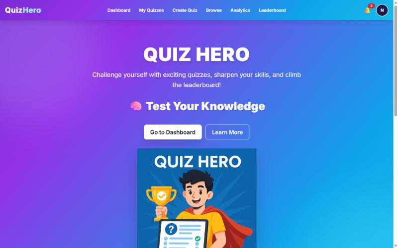
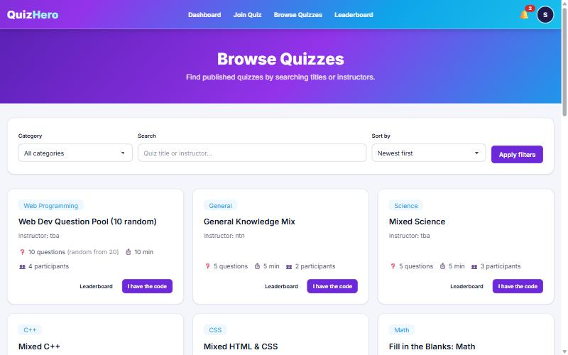
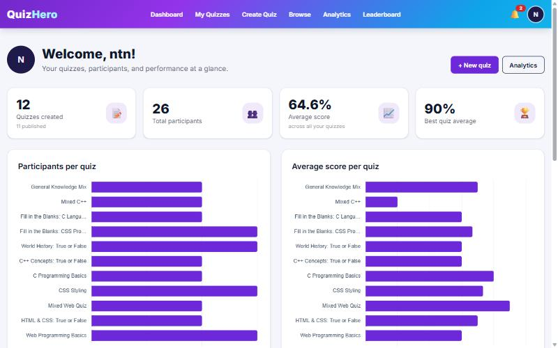
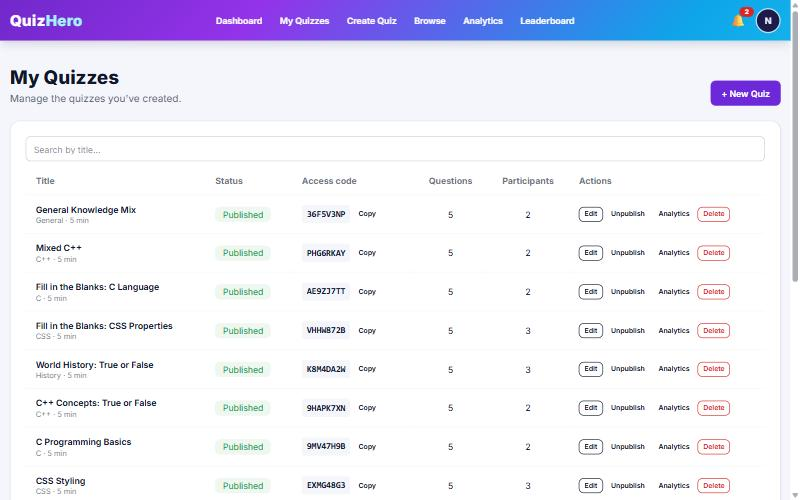
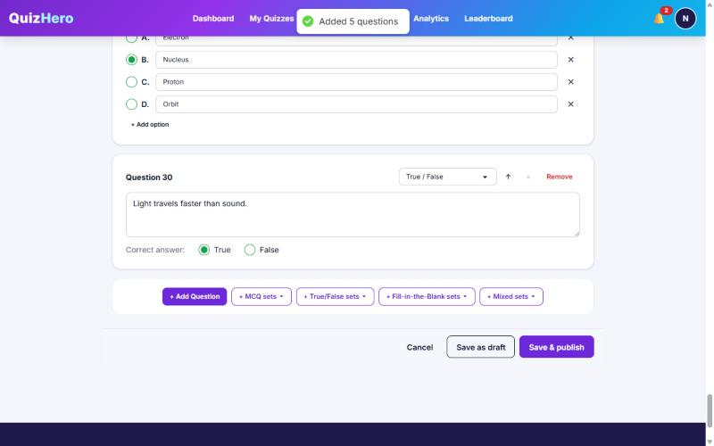
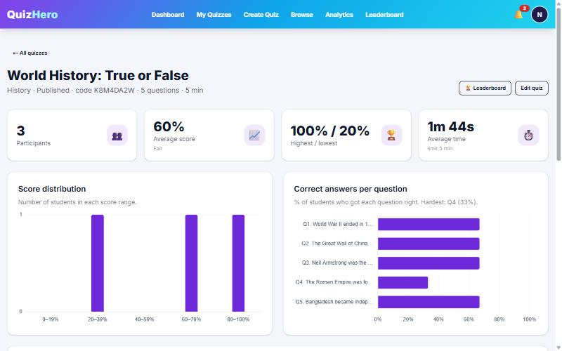
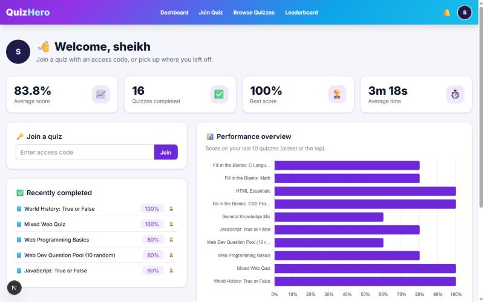
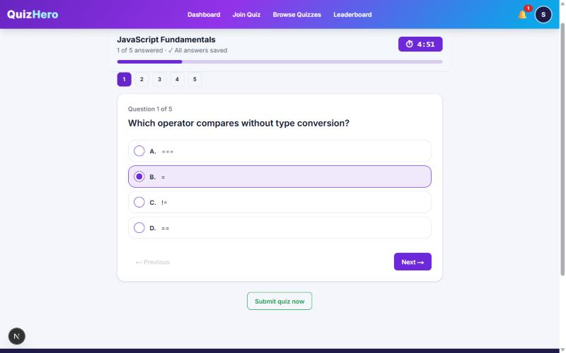
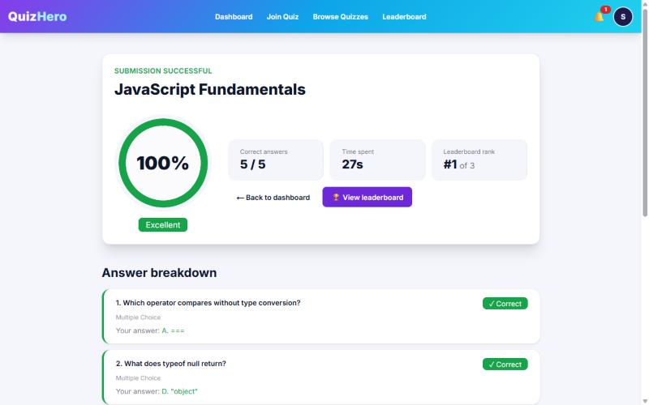
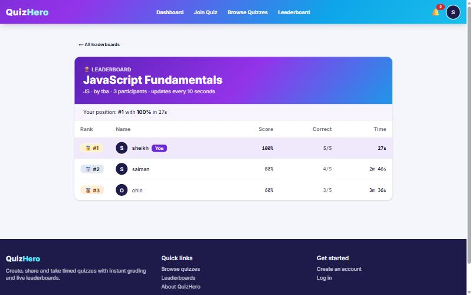

# QuizHero

QuizHero is a web-based quiz platform for classrooms and training sessions. Instructors create timed quizzes and share them through an access code. Students join with the code, answer the questions before the timer runs out, and see their score, a full answer review and their position on the leaderboard as soon as they submit.

**Live demo:** [quiz-hero-ndci.vercel.app](https://quiz-hero-ndci.vercel.app)

The project started as a PHP and MySQL course project for CSE479 (Web Programming) at East West University and was rebuilt with Next.js and MongoDB so it can be hosted on Vercel and MongoDB Atlas.

## Screenshots

| | |
|---|---|
|  |  |
| Home page | Browse quizzes |
|  |  |
| Instructor dashboard | Quiz management and access codes |
|  |  |
| Quiz builder | Quiz analytics |
|  |  |
| Student dashboard | Taking a quiz |
|  |  |
| Result and answer review | Leaderboard |

## Features

### For instructors

- Create quizzes with multiple choice, true/false and fill-in-the-blank questions
- Set a time limit and category, and add questions by hand or from a library of ready-made question sets
- Shuffle the question order and the answer options for each student
- Give each student a random selection of questions from a larger pool
- Publish a quiz to generate a unique access code, or unpublish it at any time
- Dashboard with participant counts, average scores and charts for every quiz
- Analytics for each quiz: score distribution, correct-answer rate per question and each student's submitted answers
- Notifications when students complete a quiz

### For students

- Join a quiz with its access code
- Timer controlled by the server, so refreshing the page or switching devices does not reset it
- Answers are saved automatically, and an unfinished quiz can be resumed with the same code
- The quiz is submitted automatically when time runs out
- Instant grading with a question-by-question review showing the correct answers
- Leaderboards ranked by score and then by completion time, updated live
- Dashboard with average score, best score and recent results

### General

- Separate instructor and student accounts with role-based access
- Profile photo, display name and password management
- Responsive layout for desktop, tablet and mobile

## Tech stack

- **Framework:** Next.js 15 (App Router), React 19
- **Styling:** Tailwind CSS 4, daisyUI 5
- **Database:** MongoDB Atlas with the official MongoDB Node.js driver
- **Authentication:** Better Auth (email and password)
- **Validation:** Zod
- **Charts:** Chart.js with react-chartjs-2
- **Image processing:** sharp
- **Hosting:** Vercel

## Security

- Passwords are hashed by Better Auth and never stored in plain text.
- Credentials and secrets are read from environment variables and are not committed to the repository.
- All user input is validated with Zod before it reaches the database, and IDs and search terms are sanitized to prevent query injection.
- User roles are assigned on the server. Instructor accounts require an invite code.
- Every protected page, server action and API route checks the user's role and ownership of the data being accessed.
- Uploaded profile photos are limited to 2 MB, decoded and re-encoded on the server, and stored as small WebP images.
- Quiz answers are never sent to the browser before submission, and answers received after the deadline are ignored.

## Getting started

### Prerequisites

- Node.js 20 or later
- A MongoDB Atlas cluster (the free tier is enough)

### Installation

```bash
git clone https://github.com/ssheikhs/QuizHero.git
cd QuizHero
npm install
```

Create a `.env.local` file from the example and fill in the values:

```bash
cp .env.example .env.local
```

Seed the database and start the development server:

```bash
npm run seed
npm run dev
```

The app runs at [http://localhost:3000](http://localhost:3000).

### Environment variables

| Variable | Description |
|---|---|
| `MONGODB_URI` | MongoDB Atlas connection string |
| `MONGODB_DB` | Database name (defaults to `quizhero`) |
| `BETTER_AUTH_SECRET` | Random secret used to sign sessions. Generate one with `npx @better-auth/cli secret`. |
| `BETTER_AUTH_URL` | Base URL of the app, e.g. `http://localhost:3000`. Optional on Vercel. |
| `INSTRUCTOR_INVITE_CODE` | Code required to register as an instructor. Leave empty to disable instructor sign-up. |
| `SEED_PASSWORD` | Password for the demo accounts created by the seed script (local use only) |

### Seed data

`npm run seed` creates the quiz categories, five demo accounts (two instructors and three students), a set of sample quizzes and some sample results so the dashboards and leaderboards have data to show. Demo accounts use the password set in `SEED_PASSWORD`. The script can be run more than once; it only adds records that are missing.

## Deployment

### MongoDB Atlas

1. Create a free cluster on [MongoDB Atlas](https://www.mongodb.com/atlas).
2. Under **Database Access**, add a database user with read and write access.
3. Under **Network Access**, allow access from `0.0.0.0/0`. Vercel does not use fixed IP addresses.
4. Copy the connection string from **Connect > Drivers** and use it as `MONGODB_URI`.

### Vercel

1. Import the repository on [Vercel](https://vercel.com/new). The Next.js preset is detected automatically.
2. Add `MONGODB_URI`, `MONGODB_DB`, `BETTER_AUTH_SECRET` and `INSTRUCTOR_INVITE_CODE` as environment variables.
3. Deploy. Later pushes to the `main` branch are deployed automatically.

When a custom domain is used, set `BETTER_AUTH_URL` to that domain and redeploy.

## Project structure

```
app/
  instructor/        Instructor dashboard, quiz management and analytics
  student/           Student dashboard, joining, taking and reviewing quizzes
  leaderboard/       Leaderboards
  profile/           Profile settings
  browse/            Public quiz listing
  api/               Authentication, notifications and profile photo routes
components/          Reusable UI components
lib/                 Database access, authentication, validation and grading logic
scripts/seed.mjs     Database seed script
docs/screenshots/    Screenshots used in this README
```

## Available scripts

| Command | Description |
|---|---|
| `npm run dev` | Start the development server |
| `npm run build` | Create a production build |
| `npm start` | Run the production build |
| `npm run seed` | Seed the database with categories, demo accounts and sample data |

## Acknowledgements

Originally developed as a course project for CSE479 (Web Programming) at East West University.
